

<picture>
  <source media="(prefers-color-scheme: dark)" srcset="assets/header-dark.svg">
  
</picture>

  10+ years in fintech and travel · Italy, remote (CET) 
  <a href="https://enricoschintu.com">Website</a> ·
  <a href="https://www.linkedin.com/in/enrico-schintu-schengatto/">LinkedIn</a> ·
  <a href="https://codepress.it">Codepress</a> ·
  <a href="mailto:schintu.enrico@gmail.com">Email</a>

  <i>Open to Senior / Staff Software Engineer and Forward Deployed Engineer roles, remote.</i>

---

## What I do

I'm a software engineer with hands-on team leadership experience, and I build the products the business needs. Alongside them, I build custom tools for the teams I work with, to improve their everyday work: higher productivity, better quality and a better place to work.

## How I work

<picture>
  <source media="(prefers-color-scheme: dark)" srcset="assets/workflow-dark.svg">
  
</picture>

I started in 2015 as a backend developer, writing Java and Spring batch jobs for banks, and learned that data outlives every interface built on top of it. Yet the problem rarely ended at the API, so I crossed over to the frontend, and by 2018 I was leading the front-end team.

Being full stack was still not enough. A feature nobody can trust isn't done, so I took on QA and designed the integration and end-to-end strategy for my teams, with Playwright, Cucumber and real monitoring behind it. A feature nobody can deploy isn't done either, so I took on cloud ops too, from CI/CD pipelines to AWS and Terraform, and became the cloud-ops ambassador of my team at TUI Musement.

For me, building software means owning everything between the idea and the moment it runs in production for real users, with care for quality at every step. Today the team includes AI agents, and the principle hasn't changed. I ask the boring questions first, refuse complexity until it has earned its place, write the tests before I trust the code, and ship.

## Flagship: Codepress Workspace

**Jira, rebuilt for teams where humans and AI agents work side by side.** One board where work is planned, refined, built and reviewed in the same place, by people in the browser and by coding agents over MCP.

<picture>
  <source media="(prefers-color-scheme: dark)" srcset="assets/workspace-dark.svg">
  
</picture>

- Agents read the board, pick up a ready task, update it as they go and hand it back for review with evidence. Definition of Ready and Done are gates, not decoration.
- Parallel agent runs across projects, each behind its own LLM gateway, with roadmaps, milestones and reports for the humans steering them.
- Shared agent memory ([Archivist](https://github.com/Schengatto/archivist)) linked per project, so every session starts from what the team already learned.
- Build-vs-buy decided on a benchmark: 20 concurrent agents at p95 100 ms, against 25.4 s for a git/markdown board.

Node.js 24 · TypeScript strict · SQLite · MCP · server-rendered UI · self-hosted · 600+ commits, sole author · runs my own teams' work every day

Screenshots

<picture>
  <source media="(prefers-color-scheme: dark)" srcset="screenshots/workspace-board-dark.png">
  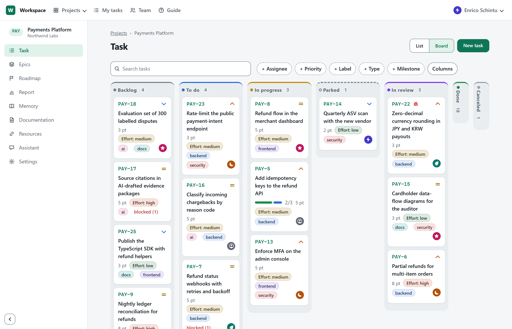
</picture>

<picture>
  <source media="(prefers-color-scheme: dark)" srcset="screenshots/workspace-task-dark.png">
  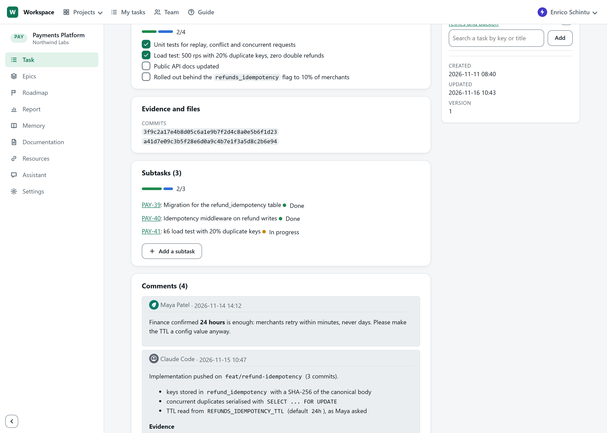
</picture>
<picture>
  <source media="(prefers-color-scheme: dark)" srcset="screenshots/workspace-run-dark.png">
  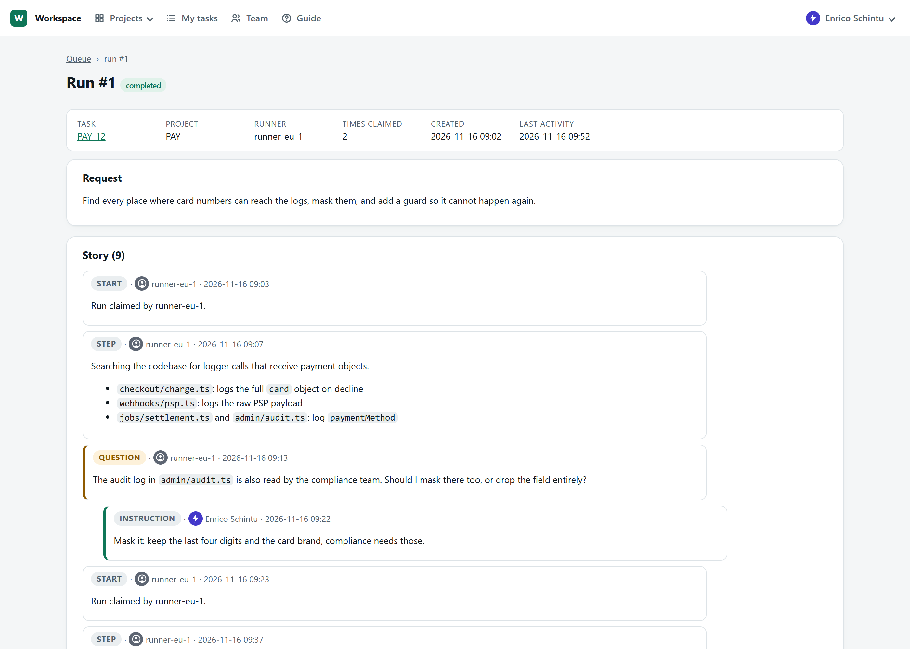
</picture>

<picture>
  <source media="(prefers-color-scheme: dark)" srcset="screenshots/workspace-roadmap-dark.png">
  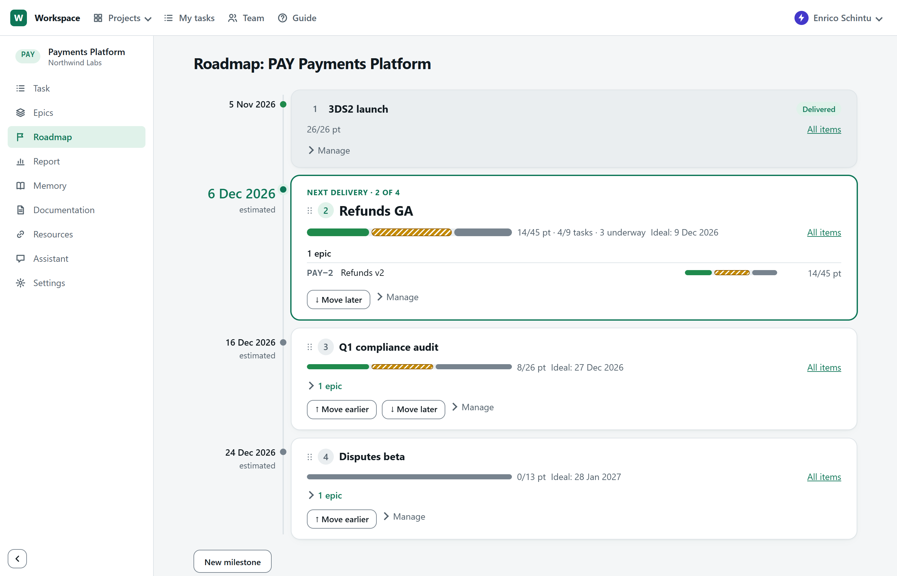
</picture>
<picture>
  <source media="(prefers-color-scheme: dark)" srcset="screenshots/workspace-report-dark.png">
  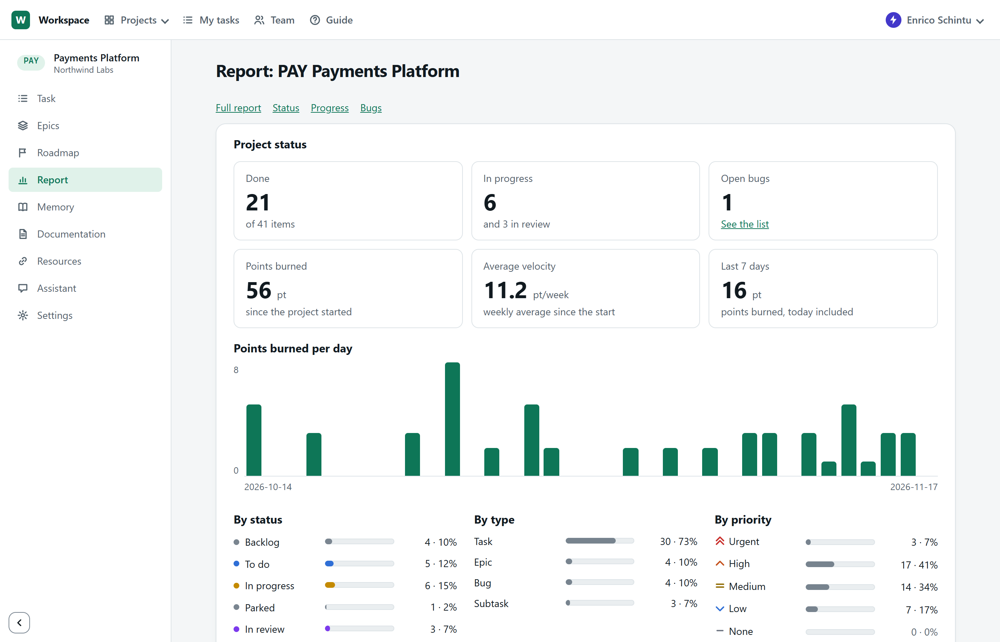
</picture>

Invented demo dataset.

## Products I built

### [Fondamentix](https://fondamentix.com)

Free value-investing platform with screener, DCF/Graham/EPV fair-value models and 13F portfolios on 1,000+ US companies, refreshed nightly. 
Nuxt 4 · PostgreSQL

Screenshots

<picture>
  <source media="(prefers-color-scheme: dark)" srcset="screenshots/fondamentix-dark.png">
  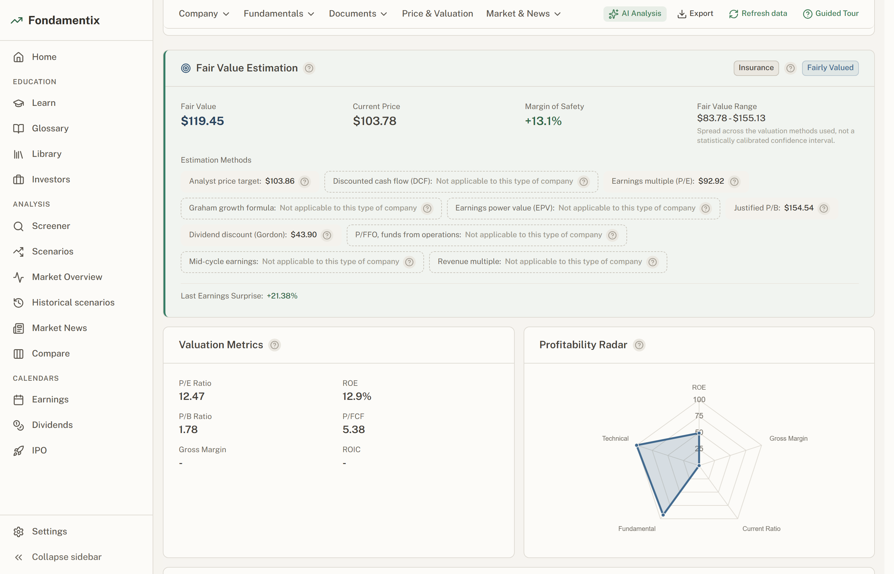
</picture>

### [Soluzione Business](https://soluzione-business.codepress.it)

Management SaaS for Italian companies (e-invoicing, tax engine, payroll) with an AI advisor exposed over MCP. 
Next.js 16 · Prisma · PostgreSQL

Screenshots

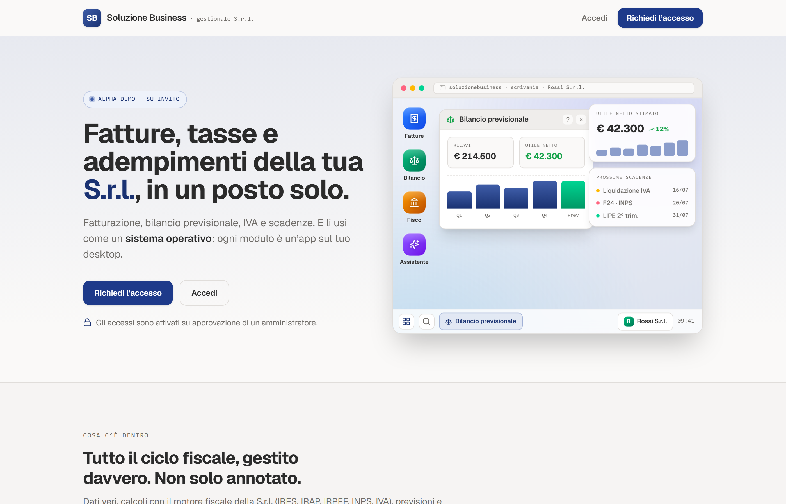

### Online gazette SaaS

A multi-tenant back-office CMS for running real online gazettes on any topic, each published through a white-label client. Editors define sources, taxonomy and branding, and Gemini reads, classifies and scores every article by sentiment and impact. Live gazettes include **[Markets Gazette](https://marketsgazette.cloud)**, with impact scored per asset and a daily consensus signal, and **[AI Gazette](https://ai.schengatto.com/)**, covering artificial intelligence. 
Nuxt · PostgreSQL · Gemini

Screenshots

<picture>
  <source media="(prefers-color-scheme: dark)" srcset="screenshots/markets-gazette-dark.png">
  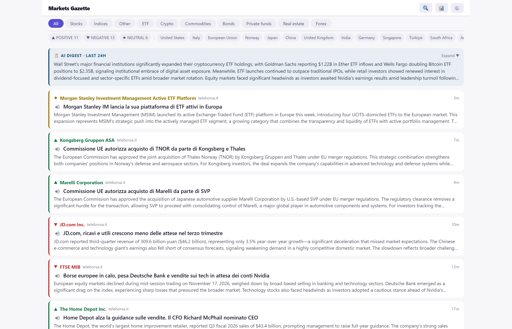
</picture>

### [TubeToo](https://tube-too.netlify.app/)

Ad-free YouTube player as an installable PWA. 
TypeScript

Screenshots

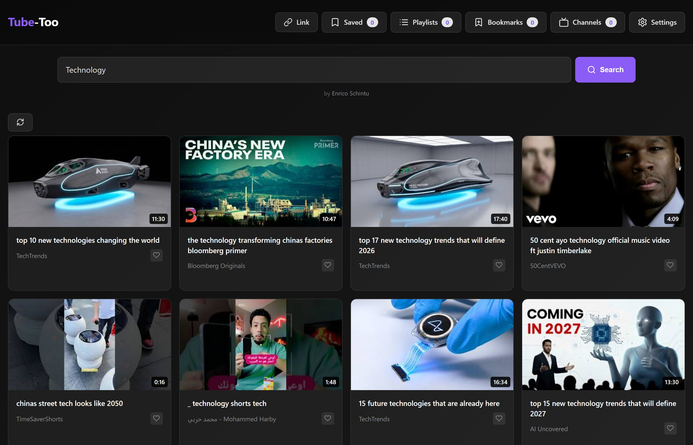

## AI-native engineering

### [Archivist](https://github.com/Schengatto/archivist)

Shared long-term memory for teams of coding agents (Claude Code, Codex, Cursor), served as a remote MCP server. Append-only writes with merge-on-read compaction, hybrid full-text + vector search ranked with RRF, per-team isolation, no LLM on the server so cost stays flat and predictable. npm client: [`archivist-connect`](https://www.npmjs.com/package/archivist-connect). 
v1.2.0 · 570+ tests · in daily production since July 2026

### [Commercialista AI](https://commercialista-ai.codepress.it/login)

RAG assistant on Italian tax law, in production for accountants, with topic gating and role-based access. 
In production

### ai-assistant

White-label RAG framework extracted from Commercialista AI, on-premise and air-gappable, with a local-LLM provider. Powers the AI assistant of the Witzard portfolio-analytics platform. 
619 tests · installable release with CI

Stack: Python · FastAPI · Next.js · PostgreSQL + pgvector · Gemini · local LLMs · Docker · Kubernetes

## Open source

### [GitPress](https://github.com/Schengatto/git-press) · [site](https://schengatto.github.io/git-press/)

Cross-platform desktop Git GUI with a virtualized commit graph, hunk staging and drag-and-drop interactive rebase. 10 releases up to v1.0.0, installers for Windows, macOS and Linux. 
Electron · React · TypeScript

Screenshots

<picture>
  <source media="(prefers-color-scheme: dark)" srcset="screenshots/git-press-dark.png">
  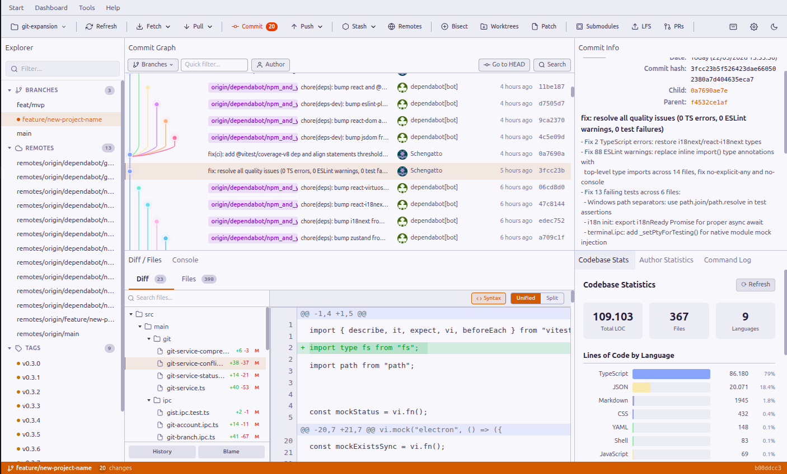
</picture>

### [trade-republic-analyzer](https://github.com/Schengatto/trade-republic-analyzer) · [live](https://schengatto.github.io/trade-republic-analyzer/)

Drop in a Trade Republic CSV and get realized P&L matched FIFO, monthly figures and a per-security breakdown. The file never leaves the browser. 
TypeScript · client-side only

Screenshots

<picture>
  <source media="(prefers-color-scheme: dark)" srcset="screenshots/trade-republic-analyzer-dark.png">
  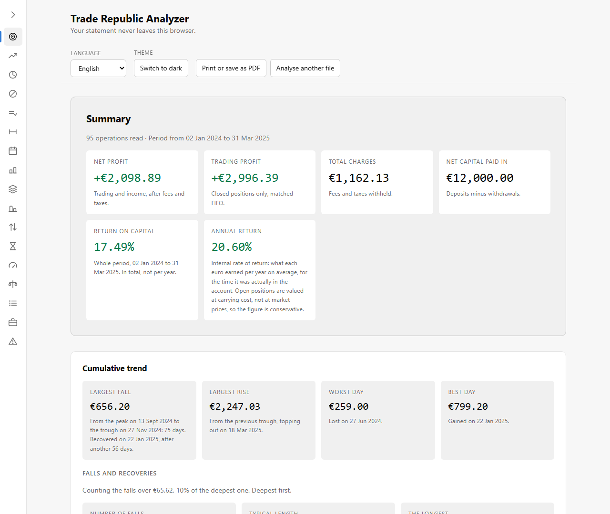
</picture>

### More on GitHub

- **[mailstore-linux](https://github.com/Schengatto/mailstore-linux)**: read-only IMAP archiver, a deduplicated and full-text-searchable local archive in one relocatable folder. Never writes to the server. Electron · React · TypeScript · SQLite
- **[create-agentic-project](https://github.com/Schengatto/create-agentic-project)**: CLI that scaffolds agent-ready repos with instruction rules, agent memory, review, security and testing gates. TypeScript · Node.js
- **[libre-city](https://github.com/Schengatto/libre-city)**: multiplayer GTA-style sandbox in the browser, desktop and mobile, over WebSocket. JavaScript · Canvas 2D · Node.js · PWA

## Stack

**Backend** 
`TypeScript and Node.js (NestJS, Fastify, Hono)` `Python (FastAPI)` `Java and Spring` `C# and .NET`

**Data** 
`PostgreSQL` `MongoDB` `SQLite` `Elasticsearch` `Prisma`

**Frontend** 
`React` `Next.js` `Vue` `Nuxt` `Angular` `Electron` `WCAG accessibility`

**AI & LLM** 
`Claude models` `GPT models` `Gemini` `local LLMs` `AI gateways (OmniRoute)` `MCP servers` `RAG with pgvector, hybrid search and embeddings` `structured output` `AI cost control`

**Cloud & DevOps** 
`AWS (ECS, Lambda, API Gateway, CloudFront, RDS, Cognito)` `Docker` `Kubernetes` `Terraform` `GitHub Actions` `Datadog` `Grafana`

**Quality** 
`TDD` `BDD with Cucumber` `Playwright` `Vitest` `Jest` `pytest` `SAST in CI`

## Experience

<picture>
  <source media="(prefers-color-scheme: dark)" srcset="assets/experience-dark.svg">
  
</picture>

---

  Got a product to take to production, or a role where this fits? <a href="mailto:schintu.enrico@gmail.com">schintu.enrico@gmail.com</a>

