<picture>
  <source media="(prefers-color-scheme: dark)" srcset="assets/header-dark.svg">
  
</picture>

10+ years in fintech and travel · Italy, remote (CET)

  <a href="https://enricoschintu.com">Website</a> ·
  <a href="https://www.linkedin.com/in/enrico-schintu-schengatto/">LinkedIn</a> ·
  <a href="https://codepress.it">Codepress</a> ·
  <a href="mailto:schintu.enrico@gmail.com">Email</a>

  <i>Open to Senior / Staff Software Engineer and Forward Deployed Engineer roles, remote.</i>

<picture>
  <source media="(prefers-color-scheme: dark)" srcset="assets/workflow-dark.svg">
  
</picture>

---

## What I do

- **Ship AI into real products.** RAG assistants in production for accountants, a white-label assistant on Kubernetes with per-request cost tracking, an AI news pipeline scoring articles per asset.
- **Build the tooling that makes AI agents useful to a team.** Shared memory and agent-driven project management over MCP, used every day by the teams I lead.
- **Make the whole team work better.** I look for what slows the team down and fix it, from the working methods we use to share knowledge and manage tasks to the tools the team turns out to need. Workspace and Archivist started this way.
- **Lead delivery end to end.** Architecture, QA strategy, CI/CD and on-call for a 6-10 person team on a tokenized-fund platform (frontend, backend, Web3).

## Flagship: Codepress Workspace

**Jira, rebuilt for teams where humans and AI agents work side by side.** One board where work is planned,
refined, built and reviewed in the same place, by people in the browser and by coding agents over MCP.

<picture>
  <source media="(prefers-color-scheme: dark)" srcset="assets/workspace-dark.svg">
  
</picture>

- Agents read the board, pick up a ready task, update it as they go and hand it back for review with evidence: Definition of Ready and Done are gates, not decoration.
- The platform orchestrates parallel agent runs across projects, each behind its own LLM gateway, with roadmaps, milestones and reports for the humans steering them.
- Shared agent memory ([Archivist](https://github.com/Schengatto/archivist)) is linked per project, so every session starts from what the team already learned.
- Build-vs-buy decided on a benchmark: 20 concurrent agents at p95 100 ms, against 25.4 s for a git/markdown board.

Node.js 24 · TypeScript strict · SQLite · MCP · server-rendered UI · self-hosted · sole author · runs my own teams' work every day

## AI-native engineering

| Project | What it is | Proof |
| --- | --- | --- |
| **[Archivist](https://github.com/Schengatto/archivist)** | Shared long-term memory for teams of coding agents (Claude Code, Codex, Cursor), served as a remote MCP server. Append-only writes with merge-on-read compaction, hybrid full-text + vector search ranked with RRF, per-team isolation, npm client [`archivist-connect`](https://www.npmjs.com/package/archivist-connect). No LLM on the server, so cost stays flat and predictable. | in daily production since July 2026 |
| **[Commercialista AI](https://commercialista-ai.codepress.it/login)** | RAG assistant on Italian tax law, in production for accountants, with topic gating and role-based access. | in production |
| **ai-assistant** | White-label RAG framework extracted from Commercialista AI: on-premise and air-gappable, with a local-LLM provider. Powers the AI assistant of the Witzard portfolio-analytics platform. | installable release with CI |

Python · FastAPI · Next.js · PostgreSQL + pgvector · Gemini · local LLMs · Docker · Kubernetes

<b>In the field</b>

- **KAIO** (2024 - present), tech lead: investor KYC on a schema-driven form engine, DocuSign subscription flows, Chainlink CCIP cross-chain integration, the encryption-key backup and rotation ceremony. Own QA (Playwright, Cucumber, Synpress), CI/CD and AWS monitoring.
- **Witzard** (2026 - present), technical collaboration: senior technical advice and hands-on code on an AI portfolio-analytics platform (backtesting, VaR/CVaR, efficient frontier). Contributed the RSS-to-Gemini news pipeline and the white-label AI assistant.
- **Codepress** (2026 - present), founder: a software house that ships fixed-scope products, audits, PoCs and enterprise RAG pilots, with tests first and full code ownership for the client.
- **TUI Musement** (2021 - 2023), senior software engineer: customer-facing tours and activities products for TUI Group, the team's E2E and monitoring approach (Playwright, Cucumber, Datadog), cloud-ops ambassador on AWS and Terraform.
- **Nivaura** (2020), senior full stack engineer: fintech microservices on AWS (Java/Spring, NestJS, Vue); infrastructure, security and architecture decisions, CI/CD and ELK observability.
- **Addvalue** (2015 - 2020), backend developer, then full stack engineer and front-end team lead (2018 - 2020): web and batch applications for banking, financial and e-commerce clients (Java/Spring, Angular, React, Elasticsearch, PostgreSQL).

## Open source

| Project | What it is | Stack |
| --- | --- | --- |
| **[GitPress](https://github.com/Schengatto/git-press)** · [site](https://schengatto.github.io/git-press/) | Cross-platform desktop Git GUI: virtualized commit graph, hunk staging, drag-and-drop interactive rebase. Installers for Windows, macOS and Linux. | Electron · React · TypeScript |
| **[trade-republic-analyzer](https://github.com/Schengatto/trade-republic-analyzer)** · [live](https://schengatto.github.io/trade-republic-analyzer/) | Drop in a Trade Republic CSV and get realized P&L matched FIFO, monthly figures and per-security breakdown. The file never leaves the browser. | TypeScript · client-side only |
| **[mailstore-linux](https://github.com/Schengatto/mailstore-linux)** | Read-only IMAP archiver: a deduplicated, full-text-searchable local archive in one relocatable folder. Never writes to the server. | Electron · React · TypeScript · SQLite |
| **[create-agentic-project](https://github.com/Schengatto/create-agentic-project)** | CLI that scaffolds agent-ready repos: instruction rules, agent memory, review, security and testing gates. | TypeScript · Node.js |
| **[libre-city](https://github.com/Schengatto/libre-city)** | Multiplayer GTA-style sandbox in the browser, desktop and mobile, over WebSocket. | JavaScript · Canvas 2D · Node.js · PWA |

## Products I built

- **[Fondamentix](https://fondamentix.com)**: free value-investing platform with screener, DCF/Graham/EPV fair-value models and 13F portfolios on 1,000+ US companies, refreshed nightly. Nuxt 4, PostgreSQL.
- **[Soluzione Business](https://soluzione-business.codepress.it)**: management SaaS for Italian companies (e-invoicing, tax engine, payroll) with an AI advisor exposed over MCP. Next.js 16, Prisma, PostgreSQL.
- **Online gazette SaaS**: a multi-tenant back-office CMS for running real online gazettes on any topic, each published through a white-label client. Editors define sources, taxonomy and branding, and Gemini reads, classifies and scores every article by sentiment and impact. Live gazettes include **[Markets Gazette](https://marketsgazette.cloud)**, with impact scored per asset and a daily consensus signal, and **[AI Gazette](https://ai.schengatto.com/)**, covering artificial intelligence. Nuxt, PostgreSQL, Gemini.
- **[TubeToo](https://tube-too.netlify.app/)**: ad-free YouTube player as an installable PWA. TypeScript.

<b>How I work</b>

I started in 2015 as a backend developer, writing Java and Spring batch jobs for banks, and learned that data outlives every interface built on top of it. Yet the problem rarely ended at the API, so I crossed over to the frontend, and by 2018 I was leading the front-end team.

Being full stack was still not enough. A feature nobody can trust isn't done, so I took on QA and designed the integration and end-to-end strategy for my teams, with Playwright, Cucumber and real monitoring behind it. A feature nobody can deploy isn't done either, so I took on cloud ops too, from CI/CD pipelines to AWS and Terraform, and became the cloud-ops ambassador of my team at TUI Musement.

For me, building software means owning everything between the idea and the moment it runs in production for real users, with care for quality at every step. Today the team includes AI agents, and the principle hasn't changed. I ask the boring questions first, refuse complexity until it has earned its place, write the tests before I trust the code, and ship.

<b>Stack</b>

| | |
| --- | --- |
| **AI & LLM** | Claude models · GPT models · Gemini · local LLMs · AI gateways (OmniRoute) · MCP servers · RAG with pgvector, hybrid search and embeddings · structured output · AI cost control |
| **Backend** | TypeScript and Node.js (NestJS, Fastify, Express, Hono) · Python (FastAPI, Django) · Java and Spring · C# and .NET |
| **Data** | PostgreSQL · MySQL and MariaDB · MongoDB · SQLite · Elasticsearch · Prisma |
| **Frontend** | TypeScript and JavaScript · React · Next.js · Vue · Nuxt · Angular · Electron · HTML and CSS · jQuery · WCAG accessibility |
| **Cloud & DevOps** | AWS (ECS, Lambda, API Gateway, CloudFront, RDS, Cognito) · Docker · Kubernetes · Terraform · GitHub Actions · GitLab CI/CD · Nginx · Apache · Datadog · Grafana · ELK Stack |
| **Integrations** | Web3 and blockchain (Chainlink CCIP) · DocuSign · Contentful headless CMS |
| **Quality** | TDD · BDD with Cucumber · Playwright · Cypress · Synpress · Selenium · Vitest · Jest · pytest · SAST in CI |
| **Team & process** | Working methods for knowledge sharing and task management · internal tooling built on the team's needs · mentorship · Git · Jira |

---

  Got a product to take to production, or a role where this fits? <a href="mailto:schintu.enrico@gmail.com">schintu.enrico@gmail.com</a>

